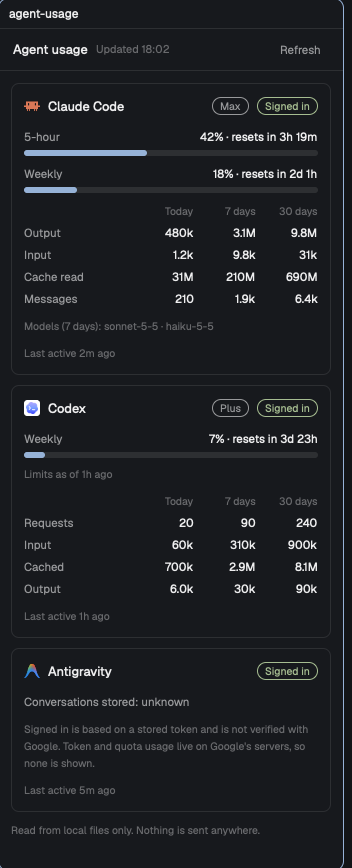

# Herdr Agent usage

A side panel for the [Herdr](https://herdr.dev) app that shows usage for the coding agents signed
in on your computer: **Claude Code**, **Codex** and **Antigravity**. Each gets a card with its
sign-in state and plan, limit bars with a reset countdown, and token totals for today, 7 days
and 30 days.



## Install

In the Herdr app, ask its agent:

```
Read ~/.config/herdr-app/AGENTS.md, then add this mod: https://github.com/unickhow/herdr-agent-usage
```

The agent copies `mods/agent-usage/` into your Herdr folder and fits it to your layout.

Requires `python3` (standard library only). Everything the mod does is described in
[RECIPE.md](RECIPE.md).

The panel reads once on start and then every 60 seconds; the **Refresh** button reads immediately.

To remove it, delete `mods/agent-usage/` from your Herdr folder (and optionally
`~/.cache/herdr-agent-usage/`).

## Privacy

The mod runs `python3` once a minute and reads local files from the three tools' own folders. It
makes no network requests. It reads counters, timestamps and yes/no sign-in checks only: never
credentials, account details or conversation text. To keep refreshes fast it caches parsed token
counts in `~/.cache/herdr-agent-usage/` (safe to delete).

## Limitations

- **Antigravity has no usage numbers.** Token and quota usage live on Google's servers. "Signed in"
  only means a login token is stored locally.
- **Claude Code limit bars need a status line that saves its input** to
  `~/.claude/hud/cache/last-input.json`. Without one, you get token totals but no bars. Claude
  Code passes its JSON (including `rate_limits`) to a status line script on stdin, so adding this
  near the top of yours is enough:

  ```sh
  input=$(cat)
  mkdir -p ~/.claude/hud/cache && printf '%s' "$input" > ~/.claude/hud/cache/last-input.json
  ```
- **Codex limits are a snapshot** from your last Codex use; the card shows how old it is.
- **Totals are not a bill.** They are what each tool recorded locally.
- Only tested on macOS with Herdr 0.1.13. Antigravity detection uses macOS paths; the Claude Code
  and Codex readers should work elsewhere but are untested.

## Files

```
RECIPE.md              what the mod looks like and how it works (the brief Herdr's agent builds from)
preview.png            screenshot
mods/agent-usage/      the mod: main.js (panel), collect.py (reads local files), mod.json
```
