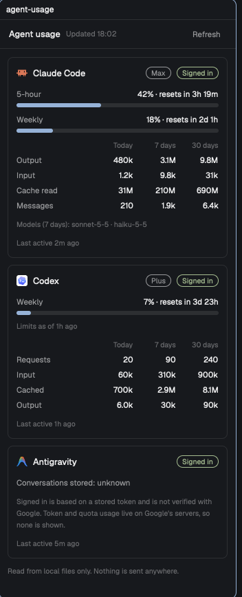

# Agent usage

A side panel for the Herdr app that shows what your coding agents have used: **Claude Code**, **Codex** and **Antigravity**. Each gets a card with its sign-in state and plan, limit bars with a reset countdown, and token totals for today, 7 days and 30 days. It reads local files only and refreshes every minute.

## What you see

A panel 300 to 368px wide on the theme's `surface` background, text from the theme. Top to bottom, scrolling when it is taller than the block:

- **Header**, 42px high, 14px horizontal padding, a `border` line below: `Agent usage` (13px, semibold, `foreground`), then `Updated 16:34` (11px, `dim`, takes the free space), then a **Refresh** text button (24px high, 8px horizontal padding, radius 6, 11.5px `muted`, `hover` fill and `foreground` text on hover). While a read runs it says `Refreshing…` in `dim`.
- **Error banner**, only when the collector fails: radius 8, `ansi1` border and 11.5px `ansi1` text, `Couldn't read local usage: <reason>`.
- **Three cards** in the order Claude Code, Codex, Antigravity, 12px padding around them and 10px between. A card has radius 8, a `surface` fill, a 1px `border` outline, 12px padding and 10px between its parts:
  - **Title row**: the agent's icon (16px, full color, from Herdr's own `icons/claude.svg`, `icons/codex.svg`, `icons/antigravity.svg`), the name (13px, semibold, truncates), a plan pill when known (`Max`, `Prolite`: first letter capitalised), and a status pill. Pills are 18px high, 7px horizontal padding, radius 9, a 1px outline and 10.5px text in one color: plan in `muted`; status `Signed in` in `ansi2`, `Signed out` in `ansi3`, `Not installed` in `dim`, `Error` in `ansi1`.
  - **Limits**, when the agent reports any. One block per limit: a row with the label on the left (`5-hour`, `Weekly`; 11.5px `muted`) and `15% · resets in 2h 55m` on the right (11.5px `foreground`); under it a 6px bar, radius 3, `border` track, the fill's width the percentage. The fill is `accent` below 70%, `ansi3` from 70%, `ansi1` from 90%. After the reset time has passed the right side reads `window reset` in `dim` and the bar is empty. Under the bars, `Limits as of 1h ago` (10.5px `dim`) when the numbers are over two minutes old.
  - **Token table**, when the agent has any totals: a header row `Today`, `7 days`, `30 days` (10.5px `dim`) over three 62px right-aligned columns, then 11.5px rows with the label in `muted` and the numbers in `foreground`. Claude Code rows: `Output`, `Input`, `Cache read`, `Messages`. Codex rows: `Requests`, `Input`, `Cached`, `Output`. Numbers read `842`, `1.7k`, `12k`, `1.5M`, `159M`.
  - **Claude Code extras**: `Models (7 days): sonnet-5-5 · haiku-5-5 · opus-5` (10.5px `dim`, the `claude-` prefix dropped), and, when there are no limits, `Limit bars need a Claude Code status line that saves its input (see the README).`
  - **Antigravity extras**: `Conversations stored: 0` (11.5px `muted`, `unknown` when it can't be read) and a 10.5px `dim` note that sign-in is based on a stored token and that token and quota usage live on Google's servers.
  - **Last line**: `Last active 3m ago` in 10.5px `dim` (`just now`, `5m ago`, `3h ago`, `2d ago`, `never`).
  - A card for a tool that isn't installed is only the title row with `Not installed`.
- **Footer**: `Read from local files only. Nothing is sent anywhere.` in 10.5px `dim`.

## How it behaves

- The panel reads once when it starts and every 60 seconds after. **Refresh** reads now; while a read is running it does nothing.
- Agent status in Herdr plays no part: the panel looks the same whatever the agents are doing.
- **Sign-in**: Claude Code is signed in when `~/.claude.json` has an `oauthAccount`; Codex when `~/.codex/auth.json` holds tokens or an API key; Antigravity when a login token is stored in the app's state database (the app or the IDE variant). These are yes or no checks; no value is shown.
- **Plan**: Claude Code from the account's organization type (`Max`, `Pro`, `Team`, `Enterprise`); Codex from the plan name on its latest rate-limit record.
- **Days** are local calendar days: today, the last 7 days including today, the last 30 days including today.
- **Claude Code tokens**: every assistant message in `~/.claude/projects/**/*.jsonl` counts once by message id, even when a transcript repeats it or a resumed session copies it. `Input` and `Output` are the model's own counters; `Cache read` is shown on its own because it dominates. Messages whose model name starts with `<` are skipped.
- **Codex tokens**: each token event in `~/.codex/sessions/**/rollout-*.jsonl` is turned into the difference from the one before it and counted on the local day it happened. `Input` excludes cached tokens, which have their own row.
- **Claude Code limits** come from `~/.claude/hud/cache/last-input.json`, a file your own Claude Code status line has to write on every update (`rate_limits.five_hour` and `rate_limits.seven_day`, each with `used_percentage` and `resets_at`). Without that file there are no bars.
- **Codex limits** come from the newest `rate_limits` record in the sessions (`primary` and `secondary`, with `used_percent`, `window_minutes`, `resets_at`); a 10080-minute window is labeled `Weekly`, 300 is `5-hour`, anything else `<n> min`.
- Parsed transcripts are cached by file size and modification time in `~/.cache/herdr-agent-usage/`, so a refresh only reads files that changed (about 30 ms when none did, 130 ms from empty on a 56 MB history).
- Nothing is clickable except Refresh. Nothing moves.

## Built from

- **One mod**, `mods/agent-usage/`, no layout. `mod.json`: `{ "place": "right", "size": 340, "title": "Agent usage" }`.
- `main.js`: a `View` (`gpui-kit` `div`, `image`; `gpui-base` `h_flex`, `v_flex`; `herdr` `exec`, `appHome`, `theme`). `init` reads once and starts `cx.timer.every(60000, …)`. A read is `exec("python3", [`${appHome()}/mods/agent-usage/collect.py`])`, its stdout parsed as JSON inside `cx.spawn`, then `cx.notify()`. The root is `v_flex().id("usage-root").size_full().overflow_y_scrollbar()`. Bar fills use a percentage width, `.w(`${pct}%`)`. Colors come from `theme()`: `surface`, `border`, `foreground`, `muted`, `dim`, `hover`, `accent`, `ansi1`, `ansi2`, `ansi3`.
- `collect.py`: Python 3 standard library only. It prints one JSON object `{ generated_at, claude, codex, antigravity }`; each part has `installed`, and then `signed_in`, `plan`, `limits` (list of `{label, used, resets_at, window_minutes}`), `limits_as_of`, `totals` (`today`, `week`, `month`), `last_active`, and agent-specific fields (`top_models`, `auth_mode`, `conversations`). A part that fails reports `{ installed: true, error }` and never stops the others.
- **Storage**: none in Herdr. The transcript cache is `~/.cache/herdr-agent-usage/claude.json` and `codex.json`; it is safe to delete.
- **Network**: none.
- **Program**: `python3`, run through Herdr's `exec`, once per refresh.
- **Files read outside the mod's folder**: `~/.claude.json`, `~/.claude/projects/**/*.jsonl`, `~/.claude/hud/cache/last-input.json`, `~/.codex/auth.json`, `~/.codex/sessions/**/rollout-*.jsonl`, `~/.gemini/antigravity/` (log files and `conversation_summaries.db`), and `~/Library/Application Support/Antigravity/User/globalStorage/state.vscdb` (and the `Antigravity IDE` equivalent), the last opened read-only. `auth.json` and the state database are opened only to check that a login exists; their contents are never printed.

## Watch out

- **Tell the person before adding it**: the mod runs a program (`python3`) every minute and reads files outside its own folder, listed above. It makes no network requests.
- Herdr's shipped layouts are replaced on every update, so a new mod's `place` may not dock into `main`. Put the mod in a layout of the person's own, or open it as a pane with `pane.split {direction: "right", mod: "agent-usage"}` (documented by Herdr; not tried while writing this recipe). The author's own setup clones the `tabs` mod and the `main` layout, adds a `usage` block to the layout's side-panel stack, and adds a Usage button to the cloned tab bar that runs `layout.select` and `layout.show`. That wiring is personal and is not part of the mod.
- Claude Code only hands its limit percentages to a running session's status line, never to a file. The mod relies on a status line saving that input: any status line script that writes Claude Code's JSON input to `~/.claude/hud/cache/last-input.json` works too. Without it, Claude Code shows tokens and no bars.
- Codex limits are the last values Codex wrote, so they are as fresh as the person's last Codex use. The card says how old they are. A snapshot whose reset time has passed shows `window reset`.
- Antigravity shows no token or quota numbers: they live on Google's servers, and reading them would mean using the person's login token against Google, which this mod must not do. `Signed in` only means a token is stored; it isn't verified. The conversation count reads `unknown` when the app has its database locked.
- Totals are what each tool recorded locally, not a bill. No cost is estimated.
- Each shown copy runs its own 60-second timer, and timers keep running while a copy is hidden. One copy is the intended setup.
- Antigravity detection uses macOS paths. The Claude Code and Codex readers use the home folder and should work elsewhere; only macOS was tested.
- Herdr's runtime has no `Intl`; numbers and the `Updated` time are formatted by hand or with `Date` helpers that were checked to work.
- Don't read, log or display anything from `auth.json` or the Antigravity state beyond whether a login exists.

## Done when

- `herdr-app check mods/agent-usage` passes.
- `python3 mods/agent-usage/collect.py` prints one JSON object with `claude`, `codex` and `antigravity` and no credentials, in under a second the first time and about 30 ms after.
- The panel shows three cards. A tool that is installed and signed in reads `Signed in` with its plan; one that isn't installed reads `Not installed` and nothing else.
- Claude Code shows `Output`, `Input`, `Cache read` and `Messages` for Today, 7 days and 30 days; Codex shows `Requests`, `Input`, `Cached` and `Output`.
- With a status line that saves its input, Claude Code shows 5-hour and Weekly bars; with the file removed the bars disappear and the hint line appears.
- A limit at 70% turns its bar `ansi3`, at 90% `ansi1`; a limit whose reset time has passed reads `window reset`.
- **Refresh** changes `Updated HH:MM`; breaking `python3` shows the red banner and keeps the last cards.
- Resizing the block between 300 and 368px never clips the token table.
